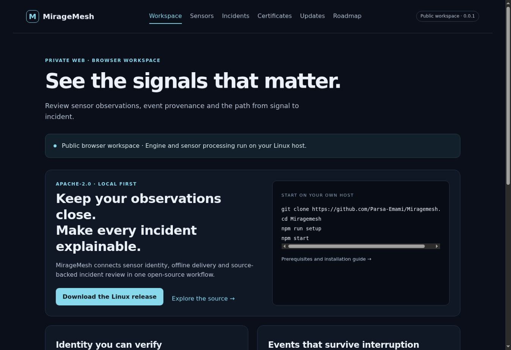
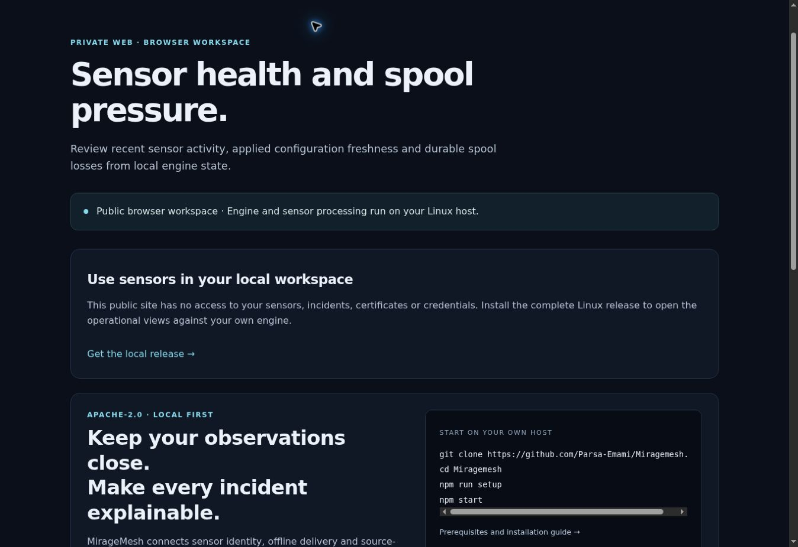
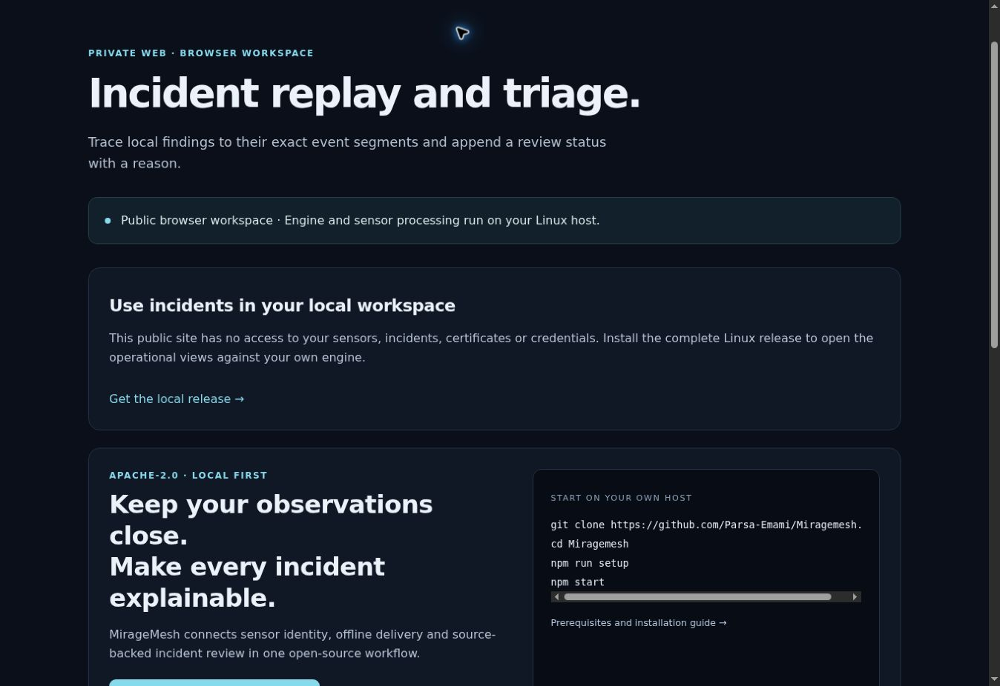
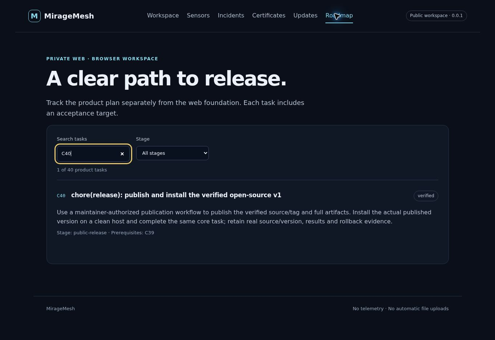

# MirageMesh: strict product and architecture review

Reviewed on 2026-11-05 against `d4dc9c829a1364a45d1202a50489be753cc5d46e`, the published `v0.0.1`, current source and four freshly captured public browser states. U01 adds a visual redesign and narrowly scoped browser improvements; it does not certify a new production backend.

## Verdict

**No: MirageMesh does not yet have the complete operational experience required of a mature, generally available hosted security web application.** It has a defensible, tested local security foundation and a published open-source package. Completing C01-C40 establishes that plan's bounded release gate, not feature parity with mature products, product-market fit, high-scale readiness or hosted multi-user security.

The most consequential gap is operational continuity: `docs/product/REFERENCE_WORKFLOW.md` explicitly describes the C30 acceptance harness, and `plans/project-state.json` states that mTLS acceptance transport is a verification harness rather than a production public ingest protocol. `npm start` does not enroll a real sensor or populate an operational estate. A standalone installed sensor, continuous authenticated collector and usable onboarding/control path must be demonstrated together before advertising unattended real-world monitoring.

Public GitHub Pages is an appropriate distribution, documentation and read-only demonstration surface. It cannot run the Go engine, isolate decoys or become the authenticated collector. Sensitive operational data should stay on an operator-owned host unless a separately validated hosting profile is introduced.

## What was actually inspected

- `AGENTS.md`, ADR-0003, execution contract, state/progress and C40 acceptance.
- React 19.3.1 / Vite 8.3.5 source, runtime configuration, all six existing routes, typed snapshot readers and incident triage.
- Go runtime entry points, alert derivation, enrollment/collector/storage modules, web proxy methods and the security threat model.
- Release, installed-workflow and workload evidence as existing source-bound records; this audit did not independently repeat all engine/provider measurements.
- Public start → Sensors → Incidents → filtered C40 roadmap flow, captured in the browser during this review.

## Public flow audit before the redesign

| Step | Task | Observed health | Finding |
|---|---|---|---|
| 1 | Understand the product and choose an action | Partial | A clear download route and privacy boundaries exist. A large marketing introduction dominates a workspace; “private web” conflicts with the public mode label. |
| 2 | Open Sensors | Blocked for live operation | The public route explains that local installation is required, then repeats the same landing content. There is no sensor workflow to try. |
| 3 | Investigate an incident | Blocked for live operation | The public route repeats the installation gate and marketing blocks; users cannot understand replay by using it. |
| 4 | Find C40 evidence | Good for delivery history | Search and status work. A verified delivery task could still be mistaken for a claim of complete product readiness. |

The before screenshots show a skip link, labelled navigation and visible keyboard focus in the roadmap filter. They do not prove screen-reader compatibility, contrast compliance, full keyboard completion or WCAG conformance. No customer interviews, external penetration test, long soak, production deployment or independent human usability study occurred in this audit.

## Capability assessment

| Area | Existing implementation/evidence | Missing or limited behavior | Priority |
|---|---|---|---|
| Sensor identity | Expiring enrollment, TLS identity guard, signed configuration and rotation primitives; real reference-workflow proof | Browser-led enrollment, sensor installer, inventory lifecycle and continuous production transport | P0 |
| Durable delivery | Bounded spool, durable ACKs, exact duplicate handling, explicit loss and restart/recovery | Continuous installed sensor-to-collector operation under a prolonged outage and real deployment upgrades | P0 |
| Investigation | Local read snapshots, segment provenance, replay, coverage and durable reasoned triage | Bounded server-side event search, time range, cursor pagination, deep links and shareable read-only reports | P0 |
| Detection | Explainable interaction/rate/loss findings | Versioned rule management, suppression windows, tuning workflow and measured false-positive evaluation; no broad SIEM/XDR detection claim | P1 |
| Alert delivery | Local findings and triage | Opt-in notifications, signed generic webhooks, retries, deduplication, throttling and delivery history | P0 |
| Onboarding | Installation guides, doctor/setup and repeatable acceptance harness | A fresh operator can connect their own sensor and find a real observation without test fixtures or internal flags | P0 |
| Hosted identity | Loopback Host/Origin checks and local operator trust model | Human login, session lifecycle, MFA/SSO integration, object-level authorization and role enforcement | P0 for team/remote hosting |
| Team workflow | Single local operator and triage reason | Owner/analyst/viewer roles, assignment, comments, permission-scoped audit and user lifecycle | P1; P0 if marketed to teams |
| Operational visibility | Liveness, readiness and bounded diagnostics | In-product readiness page, disk/spool pressure, durable job status, operator alerts and documented recovery objectives | P0 |
| Backups and upgrades | Tested local restart/restore and signed artifact verification | Operator-driven backup/restore experience, scheduled optional backup, restore verification and upgrade rollout history | P1 |
| Scale | Source-bound 5-sensor / 8 events per second / 30-second measurement under 2 vCPU and 2 GiB | Sustained realistic workloads, p95/p99 targets, high-cardinality search, multi-hour/day soak and failure saturation | P0 before larger-use claims |
| Platform support | Linux amd64, Ubuntu 24.04 reference profile | Separate validated ARM64/WSL/macOS support and signed installers; do not advertise them before evidence | P1 |
| Accessibility | Existing keyboard/reflow/failure tests | Broader screen-reader/manual checks, contrast measurement, 200–400% zoom, accessible async states and ongoing automation | P0 for public UI |
| Distribution | Public source, signed v0.0.1 and actual published-package installation proof | A new signed full release for runtime changes; Pages UI changes alone do not update the installed v0.0.1 package | P0 for the next binary release |
| Adoption | No demand validation asserted | Target-user interviews, observed completion of the real first task, repeat use and concrete support feedback | P0 for product claims |

## Comparator context

These are benchmarks for specific workflows, not interchangeable products or a feature-parity requirement.

- Thinkst Canary documents alert delivery and SIEM integration through notification channels, webhooks and APIs. That makes dependable notification delivery a relevant expectation for a deception product: https://help.canary.tools/hc/en-gb/articles/360002431478-I-want-to-integrate-my-SIEM-with-my-Canaries and https://docs.canary.tools/console-settings/notification-channels.html.
- Wazuh documents investigation/visualization and RBAC/SSO in its dashboard. These are useful expectations for a team security console, not evidence that MirageMesh supplies them: https://documentation.wazuh.com/current/getting-started/components/wazuh-dashboard.html.
- Fleet documents role-scoped operations and reference architectures. These help evaluate the sensor-estate management experience and scale assumptions: https://fleetdm.com/guides/role-based-access and https://fleetdm.com/docs/deploy/reference-architectures.

## Recommended architecture

Keep a modular Go application with explicit domain/service/port boundaries, a React interface, a same-origin web API and separate sensor processes. The current bounded single-host file adapter is useful within its measured envelope. Do not add distributed services, a message broker or a replacement database merely to look enterprise-ready.

- Domain: sensor identity, delivery, observations, incidents, rules, triage and retention invariants.
- Application: enrollment, configuration, search, triage, notification and backup use cases. Enforce actor/object permissions here, before any effect.
- Adapters: existing durable storage, TLS transport, rootless isolation, optional identity provider and opt-in notification channels. Treat each as a real failure boundary.
- HTTP boundary: versioned strict request/response contracts, bounded inputs and work, deadlines, idempotency, cursor pagination and explicit partial/stale outcomes.
- React: shared 21st-listed shadcn primitives and tokens; feature modules; typed data projections. Frontend flags never grant backend authority.
- Public distribution: static UI and explicitly labelled samples; no production secrets, real telemetry or public operational admission.

For a remote/team profile, add a same-origin backend session boundary backed by a supported optional OSS identity provider. Authorization-code flow with PKCE, secure HTTP-only cookies, CSRF defenses and server-side authorization need integration and negative tests. A login screen by itself supplies none of these controls. Keep single-operator local use available without a mandatory cloud account.

The owner restriction on schemas, migrations, `.env` and Dockerfiles still applies. Assess each extension against existing compatible ports. Record a precise blocked requirement if a protected change is necessary; do not silently make it.

## Delivery plan with real acceptance gates

| ID | Deliverable | Depends on | Observable acceptance |
|---|---|---|---|
| U01 | Consistent 21st-based UI and honest public tour | Existing local app | All six routes restyled; theme/search/keyboard work; every public sample is labelled; no operational API calls in public mode; old operational workflows still pass. |
| P01 | First real operator task | Existing engine | Fresh supported host → install → enroll an owned sensor → apply config → observe a real metadata-only event in UI, without acceptance fixtures or internal setup flags. Record exact identities and time-to-value. |
| P02 | Continuous sensor/collector service | P01 | Installed processes survive disconnect/restart, enforce mTLS identity/revocation and bounded ACK replay, report loss and recover after an extended outage. Include adversarial negative cases and safe shutdown. |
| P03 | Useful bounded investigation | P02 | Time/sensor/status filters and cursor pagination over real retained events; saved view state/deep links; source hashes and gaps remain visible; no fabricated total counts. |
| P04 | Dependable optional alerts | P02 | Explicitly enabled signed webhook reaches a controlled test receiver; timeout/retry/throttle/dead-letter and replay cases pass; all egress disabled by default. |
| P05 | Remote/team trust boundary | P01 | Real identity integration, expiring/revocable sessions, MFA path, viewer/analyst/admin object authorization, cross-object denial, CSRF and audit tests before remote writes are enabled. |
| P06 | Operator health and recovery | P02 | Readiness, storage pressure and failed jobs visible; backup/restore drill on the actual supported host; measured RPO/RTO and recovery failure states. |
| P07 | Controlled policy and lifecycle | P02, P05 for teams | Rules, suppression, sensor grouping, config rollout and certificate/update operations have preview, permissions, audit and reversible/data-safe outcomes. |
| P08 | Supported deployment and workload | P02, P03, P06 | Declare the workload first; measure latency/error/loss/CPU/RSS/disk under steady state, overload and prolonged soak. Publish only the achieved envelope. |
| P09 | Accessibility and external review | U01, P03, P05 | Manual keyboard/screen-reader/zoom checks, measured contrast, independent security review, no unresolved critical/high findings for the advertised profile. |
| P10 | Public-use release gate | P01–P09 as applicable | Fresh users complete their own real task; actual feedback retained with consent; support route/maintenance policy; signed new artifact installed and restored independently. |

P05 is not a prerequisite for an honestly labelled single-user local product. It is a prerequisite for calling that product a remotely accessible team web application. Billing, generative AI, multi-tenant SaaS and microservices are not requirements for a useful open-source security tool.

## What U01 changes and what it cannot establish

U01 changes application composition, component/tokens, navigation, theme preference, page search, local overview and explicitly synthetic public interactions. It preserves operational adapters and read/write semantics. Client-side filtering is over the loaded snapshot only; it is not indexed server-side event search. Public sample interaction is demonstration, not evidence of ingestion, detection or authentication.

The signed v0.0.1 release and its historical proofs remain immutable. Source/Pages UI can move ahead of that release. Fresh CI validates the candidate source; it does not rewrite past release provenance or establish demand, broad performance or independent audit results.
