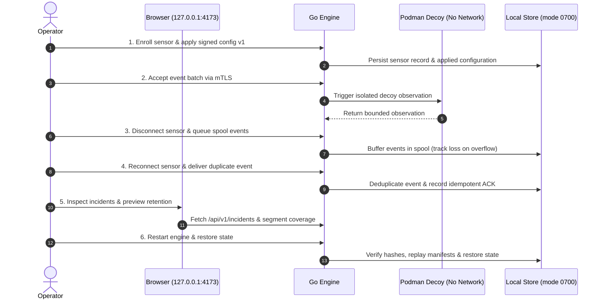

# MirageMesh: User Guide

Welcome to MirageMesh. This guide provides comprehensive, step-by-step instructions for installing, configuring, running, and managing MirageMesh in a fully open-source, local-first environment without mandatory cloud accounts, paid entitlements, or proprietary vendor locks.

---

## 1. Prerequisites & System Requirements

MirageMesh runs locally on your workstation or private server. All dependencies are pinned and open-source.

### Hardware Budget
- **CPU**: 2 vCPU (tested under enforced 2 vCPU user-scope cgroup).
- **Memory**: 2048 MiB RAM (`MemorySwapMax=0` target).
- **Free Disk**: 10 GiB free disk space recommended for local storage, image layers, and segments.
- **Sustained Throughput**: Bounded local profile of 8 events/second with 5 concurrent sensors.

### Software Requirements
- **Operating System**: Linux amd64 (e.g. Ubuntu 22.04 / 24.04 LTS) or Linux within WSL2.
- **Node.js**: `v24.19.0` (managed via nvm or package manager).
- **npm CLI**: `11.9.0` (pinned in `packageManager`).
- **Go Toolchain**: Installed `go` binary (1.21+); setup automatically selects/downloads Go `1.27.2` into local cache without altering system Go.
- **Podman**: `4.9.3` or later in rootless mode (e.g., Ubuntu reference package `4.9.3+ds1-1ubuntu0.2`) with user namespace and cgroup delegation enabled.
- **Git**: `2.40+`.

---

## 2. Clone and Quickstart

### Step 1: Clone the Repository
```sh
git clone https://github.com/Parsa-Emami/Miragemesh.git
cd Miragemesh
```

### Step 2: Bootstrap Toolchain & Dependencies
Run the reproducible bootstrap command:
```sh
npm run setup
```
`npm run setup` validates your Node, Go, and Podman versions, installs locked Node dependencies with lifecycle scripts disabled (`--ignore-scripts`), compiles web assets, and prepares the Go engine binary.

> [!TIP]
> Use `npm run setup -- --check` to inspect system prerequisites without modifying files.
> Run `npm run doctor` at any time to verify system health and runtime versions.

### Step 3: Launch Local Services
```sh
npm start
```
By default, this launches the supervised Go engine and serves the web workspace on:
```
http://127.0.0.1:4173
```
To bind to an alternative port, pass `--port`:
```sh
npm start -- --port 4301
```
Press `Ctrl+C` to gracefully terminate both the web server and the background engine process.

---

## 3. Core Reference Workflow

The core workflow demonstrates end-to-end sensor enrollment, configuration, isolated decoy observation, offline spooling, triage, and state restoration.



### Step 1: Enroll Sensor and Apply Signed Configuration
Enroll a synthetic sensor (e.g., `sensor-01`) and apply a signed configuration payload. The engine verifies the signature, applies settings monotonically, and records configuration version 1 in durable storage.

### Step 2: Accept Events & Trigger Isolated Decoy Observation
The engine ingests incoming event batches over mTLS, validating timestamps, sequence numbers, and schemas. In parallel, it triggers a decoy observation in a rootless container:
- Container runs with `--network=none`, dropped capabilities, and read-only filesystem.
- Proves zero network egress while recording bounded attacker interaction telemetry.

### Step 3: Offline Spooling & Explicit Loss Accounting
When a sensor disconnects, pending events enter a bounded offline spool. If the queue limit (`spool_limit_events`) is reached, excess events are safely dropped, and the sequence gap is durably recorded so data loss is never hidden.

### Step 4: Reconnect and Duplicate Delivery
Upon reconnecting, queued events are delivered. The engine's idempotency check detects repeated sequence numbers, updates the delivery timestamp, and returns an ACK without double-counting or duplicating records.

### Step 5: Incident Triage & Retention Preview
Open the web workspace (`http://127.0.0.1:4173/#incidents`):
- Filter and replay incidents across immutable segment projections.
- Inspect sensor health (`#sensors`) and cryptographic credentials (`#certificates`).
- Preview retention cutoffs before applying any segment expirations.

### Step 6: Graceful Restart & State Restoration
Terminate the engine process with `SIGINT` (`Ctrl+C`) or `SIGTERM`. Upon restart, the engine validates local manifests, checks SHA-256 block digests, restores the exact accepted state, and resumes service without data loss.

---

## 4. Source Builds and Packaging

MirageMesh can be packaged into reproducible, self-contained distribution bundles without internet access at runtime.

### Building Release Artifacts
```sh
npm run package
```
This builds:
1. `miragemesh-web`: Compiled static frontend bundle.
2. `miragemesh-engine`: Native Go binary compiled with hardened compiler flags.
3. `miragemesh-source.tar.gz`: Complete, reproducible source archive.
4. `SBOM`: Software Bill of Materials (SPDX format) listing all dependencies and licenses.
5. `SHA256SUMS.txt`: Cryptographic checksums of all build outputs.

### Verifying Built Artifacts
Verify the packaging and integrity of artifacts in `dist/release/`:
```sh
npm run verify:artifact
```
This confirms that binaries match declared checksums, the SBOM is valid, and the release bundle contains all required offline resources.

---

## 5. Data Storage & Local Durability

MirageMesh adheres strictly to local-first architecture (ADR-0003):
- **Local Private Store**: Persistent state is written exclusively to private directories created with POSIX permissions `0700` (`rwx------`).
- **Atomic Manifest Publication**: Updates are written to temporary staging files, fsynced to disk, and published via atomic directory renames.
- **Append-Only Segments**: Event projections use immutable, bounded segments to eliminate database corruption risks.
- **Zero Cloud Storage**: No external database (PostgreSQL, MongoDB), cloud bucket (S3, GCS), or remote key-value store is ever required.

---

## 6. Operational Limits and Quotas

MirageMesh enforces explicit operational bounds to protect system resources:
- **Throughput**: 8 events/s sustained ingestion under 2 vCPU / 2048 MiB RAM constraint.
- **Batch Size**: Maximum 100 events per ingestion batch; maximum payload size 1 MiB.
- **Spool Capacity**: Bounded in-memory and on-disk spool queues with configurable drop-and-record semantics.
- **Segment Retention**: Configurable time and size-based retention policies.
- **Decoy Limits**: Hard memory limit of 64 MiB and PID limit of 32 per decoy container.

---

## 7. Privacy and Network Confinement

MirageMesh is engineered with a strict "no egress by default" policy:
- **Loopback Bindings**: By default, the web interface and API listen only on `127.0.0.1` and `::1`.
- **Zero Telemetry**: No usage metrics, crash reports, heartbeat pings, or analytics are sent to external servers.
- **Decoy Isolation**: Decoy containers have no network interfaces other than loopback (`--network=none`).
- **Reverse Proxy Support**: For remote team access, deploy behind an authenticated TLS reverse proxy (e.g. Nginx). See [deployment.md](../../infra/deployment.md).

---

## 8. Backup, Recovery, and Disaster Handling

### Creating a Backup
Because MirageMesh uses standard file-based storage, backing up state is simple:
1. Stop the supervisor (`Ctrl+C`) to ensure no writes are in progress.
2. Copy the private state directory:
   ```sh
   cp -a ~/.local/state/miragemesh /path/to/secure/backup/
   ```
3. Restart the supervisor: `npm start`.

### Standalone Retention Expiry
To preview or expire stale event segments:
```sh
# Preview expired segments without deleting:
miragemesh --expire-segments --retention-cutoff 2026-10-01T00:00:00Z --data-dir ~/.local/state/miragemesh

# Apply retention deletion:
miragemesh --expire-segments --retention-apply --retention-cutoff 2026-10-01T00:00:00Z --data-dir ~/.local/state/miragemesh
```

### Certificate Rotation
Rotate sensor and server certificates offline:
```sh
miragemesh --rotate-certificates --cert-dir ~/.local/state/miragemesh/certs
```
Inspect certificate status in the UI at `#certificates`.

---

## 9. Community & Support

MirageMesh is a transparent open-source project licensed under [Apache-2.0](../../LICENSE).

- **Source Code**: [GitHub Repository](https://github.com/Parsa-Emami/Miragemesh)
- **Bug Reports & Feature Requests**: Open an issue on GitHub. Please check existing issues before creating duplicates.
- **Community Contributions**: See [CONTRIBUTING.md](../../CONTRIBUTING.md) for pull request guidelines and code standards.
- **License Compliance**: Detailed notices for third-party libraries are maintained in [THIRD_PARTY_NOTICES.md](../../THIRD_PARTY_NOTICES.md).
- **Security Vulnerabilities**: Do **not** open public GitHub issues for security bugs. Follow the instructions in [SECURITY.md](../../SECURITY.md).

---

## 10. Failure Handling and Accessibility

MirageMesh is designed to remain fully usable and transparent during failures:
- **Input Sanitization**: All user inputs, metadata, and log fields are rendered as inert text nodes. Malicious script or HTML sentinels (e.g. `<script>`, `onerror=`) cannot execute.
- **Keyboard Navigation**: All features are accessible via keyboard navigation (`Tab`, `Shift+Tab`, `Enter`, `Space`), with a dedicated "Skip to content" link.
- **Mobile Ergonomics**: All status pages, data tables, and error alerts are fully responsive at 360px viewports without horizontal document scrolling.
- **Explicit Error Displays**: If the engine or Podman provider is unavailable, clear HTTP 503 alerts appear in designated region/alert landmarks rather than failing silently.
